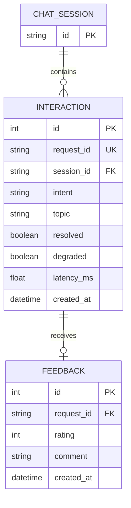

# Lab 5 — Data model worksheet

## 1. Critique the bad schema (sql/bad_schema.sql)

| # | Problem | Why it hurts | Fix |
|---|---|---|---|
| 1 | Personal information (`student_name`, `student_phone`) is stored unnecessarily. | It creates privacy risks and exposes sensitive personal information. | Do not store student names or phone numbers. Store only a hashed session ID. |
| 2 | Full raw messages and answers (`message`, `answer`) are stored. | Raw messages may contain personal information, and storing them indefinitely creates unnecessary privacy risks. | Store only the metadata needed for analysis, such as intent, topic, resolution status, and latency. |
| 3 | Feedback is stored as a comma-separated string (`feedback`). | It is difficult to query, count, or filter individual ratings. It also violates atomicity because multiple values are stored in one field. | Create a separate `feedback` table with one row per feedback record and a foreign key to the interaction. |
| 4 | Intent is stored as unrestricted free text (`intent`). | The same intent may be recorded inconsistently, such as `fee`, `Fee`, `FEE`, and `tuition`, making analysis unreliable. | Use consistent predefined intent values. |
| 5 | Time is stored as text (`time`). | Text timestamps are difficult to sort, filter, and calculate accurately when formats differ. | Store a proper datetime value in a `created_at` column. |
| 6 | Latency is stored as text (`latency`). | Values such as `120ms` are not numeric, making averages and other calculations difficult. | Store latency as a numeric value, such as `latency_ms REAL`. |

## 2. Store or not? (privacy-aware storage)

| Data | Store? | Form (raw / hashed / aggregated / none) | Retention | Reason |
|---|---|---|---|---|
| raw user message | No | none | none | May contain personal information; the feature does not need it. |
| session id | Yes | hashed | As needed for analysis | Allows session counting without storing the original identifier. |
| intent, latency, topic | Yes | raw structured metadata | As needed for analysis | Supports analysis of common questions and system performance. |
| feedback rating | Yes | raw | As needed for analysis | Enables feedback analysis and quality improvement. |
| feedback comment | Yes, optionally | raw | Only as long as needed | Supports qualitative feedback, but may contain personal information. |
| student name / phone | No | none | none | Not required by the assistant's features and creates privacy risks. |

## 3. Product questions → fields

| Product question | Fields needed | Table(s) | Query sketch |
|---|---|---|---|
| Most failed intent? | `intent`, `resolved` | `interaction` | `GROUP BY intent`, filter `resolved = 0`, order by count descending |
| Average response time by intent? | `intent`, `latency_ms` | `interaction` | `GROUP BY intent`, calculate `AVG(latency_ms)` |
| Top unresolved topics? | `topic`, `resolved` | `interaction` | Filter `resolved = 0`, group by `topic`, order by count descending |

## 4. ER diagram

The diagram below shows the three entities, their keys, and their relationships.

